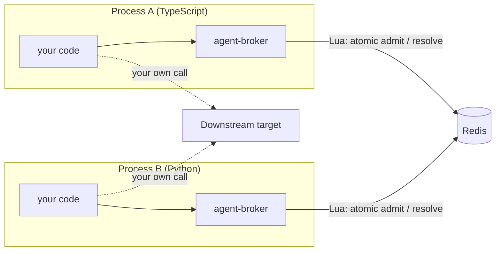

# agent-broker

**A Redis-backed admission gate for multi-process agent and LLM-calling systems, with TypeScript and Python implementations that coordinate through the same Redis.**

`agent-broker` answers one question, correctly, under real concurrency and across real process boundaries: *"Is this call allowed to happen right now?"* It accounts for shared budget, delegation depth, in-flight concurrency, and recent failure history against the target you are about to call. It does **not** make the call for you: you ask before, you report after, and you stay in full control of the request itself.

| | TypeScript | Python |
|---|---|---|
| Status | **Published on npm** ([`agent-broker`](https://www.npmjs.com/package/agent-broker)) | **Not yet published.** Install from this repository (below). Not on PyPI. |
| Source | [`typescript/`](typescript/) | [`python/`](python/) |
| Install | `npm install agent-broker ioredis` | `pip install "git+https://github.com/Devpaul-01/agent-broker.git#subdirectory=python"` |
| Runtime | Node.js 22+, `ioredis` 5 or 6 | Python 3.10+, `redis-py` 5+, async (`redis.asyncio`) |
| Docs | this README, [`typescript/`](typescript/README.md) | [`python/README.md`](python/README.md) |

Both implementations are feature-complete against the same operations and run the **same Lua scripts against the same Redis keys**, so a TypeScript process and a Python process can draw from one budget pool and one circuit breaker. That is exercised by real cross-language tests (see [Verifying it](#verifying-it)), not just asserted.

```
your process → broker.requestPermission(...) → { allowed: true, reservationId }
your process → (you make the real call yourself, however you want)
your process → broker.reportOutcome({ reservationId, success, actualCost })
```

> **Coming next:** a LangGraph-native integration is in development and not yet released. See [Project status](#project-status-and-roadmap).

---

## The problem, and what the library does about it

If more than one process, agent, or user session shares a downstream resource (an LLM provider, a rate-limited API), three problems appear that no single process can fix by being better written:

| Failure at scale | Why it is invisible locally | How agent-broker handles it |
|---|---|---|
| **Correlated retries.** Ten processes each retry twice, so the target sees a burst of 20. | Each process looks well-behaved on its own. | A sliding-window failure count per target, shared via Redis. Crossing a soft threshold returns a `retryAfter` backpressure hint; crossing the hard threshold opens a circuit that admits only a small `probeRate` of calls as recovery probes. |
| **Budget races.** Two processes both see "enough budget" a few milliseconds apart and both spend it. | The check-then-spend gap is invisible without shared state. | Check-and-reserve is one atomic Lua script. The reservation is reconciled against actual cost when you report back. |
| **Unbounded delegation.** An agent spawns sub-agents that spawn more. | Depth is a property of the whole tree, not of any node. | Child identity, depth, root and budget key are derived by the broker from stored parent state inside one atomic script, never accepted from the caller. |

Concurrency is bounded per `(target, budgetKey)` pair in the same atomic admission step.


## Architecture at a glance

The broker is an **in-process library**, not a service: every application process links it and talks to one shared Redis. There is no broker process to deploy.



Four Lua scripts are the entire coordination surface. `REQUEST_PERMISSION` checks agent existence, circuit state, budget, and concurrency and reserves against all of them in one round trip. `RESOLVE_RESERVATION` is the single path that closes a reservation, shared by `reportOutcome` and the lazy cleanup of abandoned reservations. `REGISTER_CHILD` and `ADD_BUDGET` cover delegation and budget top-ups. The full request lifecycle, Redis data model, failure model, and sequence and state diagrams are in [`docs/ARCHITECTURE.md`](docs/ARCHITECTURE.md).

---

## Installation and quick start

You need a reachable Redis (local, containerized, or managed). The library never creates or owns a Redis connection; you pass your own client in ([ADR-0006](docs/adr/0006-no-owned-redis-connection.md)).

### TypeScript

```bash
npm install agent-broker ioredis
```

Requires Node.js 22 or later. `ioredis` (`^5` or `^6`) is a peer dependency.

```ts
import { createBroker } from "agent-broker";
import { Redis } from "ioredis";

const broker = createBroker({ redis: new Redis(process.env.REDIS_URL) });

// Register a root agent and fund its budget pool.
const root = await broker.register({ budgetKey: "user-123", initialBudget: 5000 });

// Before calling a downstream resource, ask permission.
const decision = await broker.requestPermission({
  agentId: root.agentId,
  target: "groq:llama-3.3-70b-versatile",
  estimatedCost: 800,
});
if (!decision.allowed) {
  // decision.reason: 'unknown_agent' | 'aborted' | 'budget_exceeded' | 'concurrency_exceeded'
  //                | 'circuit_open' | 'redis_unavailable' | 'queue_timeout'
  // ('aborted' and 'queue_timeout' only occur in queue mode.)
  throw new Error(`denied: ${decision.reason}`);
}

// Make your actual call however you normally would, then report back.
const response = await yourLLMClient.call(/* ... */);
await broker.reportOutcome({
  reservationId: decision.reservationId,
  success: true,
  actualCost: response.usage.totalTokens,
});

// Delegate to a sub-agent. depth, rootId and budgetKey are derived by the broker.
const child = await broker.register({ parentId: root.agentId });
if ("allowed" in child && child.allowed === false) {
  // child.reason: 'depth_exceeded' | 'unknown_agent'
}

// If the downstream call fails transiently instead, report it as retryable; this failure
// then counts toward the shared circuit-breaker state for the target:
//   await broker.reportOutcome({ reservationId: decision.reservationId, success: false, retryable: true });
```

### Python (not yet published)

The Python package is **not on PyPI** and has no release yet. Until it is published, install it from this repository. Its distribution name in [`python/pyproject.toml`](python/pyproject.toml) is `agent-broker` and its import name is `agent_broker`.

```bash
# directly from GitHub (default branch)
pip install "git+https://github.com/Devpaul-01/agent-broker.git#subdirectory=python"

# or from a local checkout, editable, with test tooling
git clone https://github.com/Devpaul-01/agent-broker.git
pip install -e "agent-broker/python[dev]"
```

Requires Python 3.10 or later. `redis-py` 5+ is installed automatically. The API is async-only.

```python
import asyncio
import redis.asyncio as redis
from agent_broker import (
    Admitted, BrokerOptions, RegisterChildInput, RegisterDenial, RegisterRootInput,
    ReportOutcomeInput, RequestPermissionInput, create_broker,
)

async def main() -> None:
    client = redis.Redis.from_url("redis://localhost:6379", decode_responses=True)
    broker = create_broker(BrokerOptions(redis=client))

    root = await broker.register(RegisterRootInput(budget_key="user-123", initial_budget=5000))

    decision = await broker.request_permission(
        RequestPermissionInput(agent_id=root.agent_id, target="groq:llama-3.3-70b-versatile", estimated_cost=800)
    )
    if not isinstance(decision, Admitted):
        raise RuntimeError(f"denied: {decision.reason}")

    # ... make your real call, then report back ...
    await broker.report_outcome(
        ReportOutcomeInput(reservation_id=decision.reservation_id, success=True, actual_cost=743)
    )

    child = await broker.register(RegisterChildInput(parent_id=root.agent_id))
    if isinstance(child, RegisterDenial):
        ...  # child.reason: "depth_exceeded" | "unknown_agent"

    await client.aclose()

asyncio.run(main())
```

Runnable versions live in [`python/examples/`](python/examples/). Python-specific details (async usage and cancellation, hooks, error handling) are in [`python/README.md`](python/README.md).

---

## What this is not

To save you a wrong assumption: this is **not** an LLM gateway in the sense of Portkey, LiteLLM, or Cloudflare AI Gateway. Those sit *in* the request path — they route, cache, and proxy the actual call to the provider. `agent-broker` never touches the provider at all. It solves a narrower, different problem: cross-process safety coordination, not request routing. See [`docs/ARCHITECTURE.md`](docs/ARCHITECTURE.md) for the full boundary discussion.

It is also not a security boundary against a malicious caller. It protects against *accidental* and *architectural* bypass — not against a process owner willing to lie to it. See [Trust model](#trust-model) below.

## Core concepts

| Concept | What it means here |
|---|---|
| **Agent** | A node in a delegation tree. Not a reasoning loop or a prompt — just an identity, a depth, a parent, and a budget key. Broker-issued, never caller-chosen. |
| **`target`** | An opaque string you choose to represent "which downstream thing is this." Convention: `provider:model` (e.g. `"anthropic:claude-opus"`). The broker doesn't parse it — it only groups shared state by it. |
| **`budgetKey`** | Scopes a shared spending pool. Defaults to the root agent's own ID (private by default). Pass the same key across unrelated roots to intentionally share a budget. |
| **Reservation** | A hold placed on `estimatedCost` at admission time, reconciled against `actualCost` once you report back. |
| **Circuit breaker** | Shared, cross-process failure tracking per `target`. Trips to `open` once recent `retryable: true` failures cross a threshold; recovers via a small trickle of probe calls. |

Full mechanics, invariants, and the reasoning behind each of these are in [`docs/ARCHITECTURE.md`](docs/ARCHITECTURE.md).

---

## Configuration

TypeScript shown; the Python package takes the same options as snake_case fields of `BrokerOptions` (`max_depth`, `agent_ttl`, `concurrency_limit`, `on_redis_unavailable`, `circuit_breaker=CircuitBreakerOptions(...)`, `hooks=BrokerHooks(...)`) with identical defaults and validation.

```ts
const broker = createBroker({
  redis,                                  // required — your own ioredis client
  maxDepth: 5,                            // delegation depth ceiling
  agentTtl: 3_600_000,                    // ms, how long an idle agent stays registered (must be >= maxReservationTtl)
  defaultReservationTtl: 30_000,          // ms, used when a call omits `ttl`
  maxReservationTtl: 300_000,             // ms, hard ceiling a caller's `ttl` cannot exceed
  concurrencyLimit: 10,                   // in-flight calls per (target, budgetKey) pair
  onRedisUnavailable: "deny",             // 'deny' | 'allow' — see "Failure behavior" below
  circuitBreaker: {
    softThreshold: 5,                     // failures before `retryAfter` backpressure appears
    hardThreshold: 20,                    // failures before the circuit opens
    windowMs: 60_000,                     // sliding window for failure counting
    probeRate: 0.1,                       // fraction of open-circuit calls admitted as recovery probes
  },
  hooks: {
    onDecision(event) {},                 // fires on every requestPermission outcome
    onOutcome(event) {},                  // fires on every reportOutcome call
    onCircuitStateChange(event) {},       // fires only on open/closed transitions
    onCleanup(event) {},                  // fires when a lazy sweep resolves an abandoned reservation
  },
});
```

All configuration is immutable for the lifetime of a broker instance. If you need different limits, construct a second broker instance rather than mutating this one — see [ADR-0007](docs/adr/0007-immutable-broker-config.md) for why.

## Failure behavior

If Redis is unreachable, `onRedisUnavailable` decides what happens, and it defaults to the conservative option:

- **`'deny'`** (default): calls are denied with `reason: 'redis_unavailable'`. The one moment coordination can't function is exactly the moment you don't want to silently lose the guarantees it provides.
- **`'allow'`**: calls are admitted without a reservation (`degraded: true`, `reservationId: null`). Pick this only if raw availability matters more than the coordination guarantees during an outage — this library will not make that tradeoff silently on your behalf.

See [`docs/ARCHITECTURE.md`](docs/ARCHITECTURE.md#12-failure-model) for the full failure model, including a flow diagram of every denial and recovery path.

## Queue mode

By default, a denied call is just denied (`mode: 'deny'`). If you'd rather wait for a slot/budget/recovery instead of handling the denial yourself:

```ts
await broker.requestPermission(
  { agentId, target, estimatedCost },
  { mode: "queue", queueTimeout: 10_000 },
);
```

This polls the same atomic admission path with backoff until admitted, `queueTimeout` elapses (`reason: 'queue_timeout'`), or the denial reason is one that waiting can never fix (`unknown_agent` returns immediately, not after a timeout). You can also pass an `AbortSignal` (`{ mode: "queue", signal }`) to cancel the wait externally; an aborted wait resolves with `reason: 'aborted'`.

---

---

## Trust model

This is an in-process library. The process that imports it fundamentally controls its own inputs. What `agent-broker` protects against, and what it explicitly does not, is worth stating plainly rather than overselling:

**Protected against:**
- A caller accidentally claiming a different agent identity, depth, parent, or root — impossible, since these are always broker-derived from stored state, never accepted as raw caller input.
- Ordinary concurrent overspend — closed via atomic check-and-reserve.
- Accidental unbounded recursion — closed via broker-enforced, registration-time depth checks.

**Not protected against (by design, not oversight):**
- A caller that simply doesn't use the delegation API honestly (e.g., registering a fresh root to "reset" its own depth rather than genuinely delegating). Nothing requires a caller to delegate through the API in the first place.
- A caller that misreports `retryable`, `actualCost`, or `success` on `reportOutcome` — the broker never observes your actual downstream call or response, so it has no independent way to verify what you tell it.
- A caller that never calls `reportOutcome` at all — bounded by reservation TTL, not eliminated.

If you need protection against a genuinely adversarial, non-cooperating caller, you need a boundary this library doesn't provide (e.g., a service-mode deployment with its own auth). See [`docs/ARCHITECTURE.md`](docs/ARCHITECTURE.md#17-security-and-trust-boundaries).

---

## Engineering highlights

For a reviewer short on time, these are the mechanisms worth reading first. Paths are the
TypeScript implementation; the Python package contains the same scripts and logic under
`python/src/agent_broker/`.

- **Single-round-trip admission control.** `requestPermission` checks agent existence, circuit
  state, budget, and concurrency, and reserves against all of them, in one Lua script —
  `typescript/src/admission/request-permission.ts`, [ADR-0023](docs/adr/0023-single-combined-admission-script.md).
- **Idempotent reservation reconciliation shared by two call paths.** The same script resolves a
  reservation whether it's an explicit `reportOutcome` call or a lazy sweep discovering an
  abandoned one, closing the class of bug where two independently-written resolution paths
  quietly drift apart — `typescript/src/admission/resolve-reservation.ts`,
  [ADR-0002](docs/adr/0002-reportoutcome-refund-formula.md),
  [ADR-0003](docs/adr/0003-budget-pool-deletion-handling.md).
- **Single-probe circuit recovery**, a deliberate simplification from an originally-planned
  multi-state design, with the trade-off reasoned through rather than assumed —
  [ADR-0010](docs/adr/0010-single-probe-circuit-recovery.md).
- **Broker-derived identity closing a TOCTOU spoofing window.** A child's depth, `rootId`, and
  `budgetKey` are re-derived from the parent's stored state inside the same atomic script that
  creates the child — never accepted as caller input — `typescript/src/agents/register-child.ts`,
  [ADR-0012](docs/adr/0012-broker-derived-identity-and-depth.md).
- **Real cross-process testing**, not simulated concurrency: the test harness forks genuine OS
  processes and verifies state visibility and error propagation across them —
  `typescript/test/helpers/harness.ts`, `typescript/test/integration/cross-process-harness.test.ts`.
- **Honest non-atomicity where it's actually safe.** `register()` for a root agent uses
  `MULTI`/`EXEC`, not Lua — a deliberate, narrower choice than the Lua-backed paths above. The
  code comment states the exact failure window (a dropped connection before reply can leave an
  orphan agent and/or orphan budget pool) and why it's harmless, rather than glossing over it —
  `typescript/src/agents/register.ts`.

See [`docs/ARCHITECTURE.md`](docs/ARCHITECTURE.md) for the full request lifecycle, Redis data
model, and failure model, with diagrams.

---

## Verifying it

Integration and cross-language tests need a real Redis (no mocks, by design) and **flush database 15** of the instance they point at, so never aim them at a Redis you care about. They default to `redis://localhost:6379/15` and can be redirected with `TEST_REDIS_URL`. A missing Redis fails the tests loudly rather than skipping them.

```bash
# Redis (either works; the TypeScript package ships a compose file)
docker run -d -p 6379:6379 redis:7-alpine
# or: cd typescript && npm run redis:up

# TypeScript
cd typescript && npm ci
npm run typecheck && npm test

# Python
cd python && pip install -e ".[dev]"
mypy --strict src/agent_broker
pytest tests/unit tests/integration

# Cross-language: real TypeScript and Python workers sharing one Redis
cd typescript && npm ci && cd ..          # the TypeScript worker needs its dependencies
pytest test/cross-language/ -v
```

What the suites cover:

- **Cross-process atomicity.** Both languages fork real OS processes (not threads or async tasks) that race for one budget pool, one concurrency limit, and one circuit breaker, and assert on exact admission counts.
- **Crash recovery.** A process is killed mid-call; a later `requestPermission` sweeps the abandoned reservation and refunds it exactly once, including when a late report races the sweep.
- **Cross-language interoperability** ([`test/cross-language/`](test/cross-language/)): one language registers and the other admits against it; both race one pool; one language's failures open a circuit the other observes; one language's cleanup recovers the other's abandoned reservation. A shared set of language-neutral behavioral cases is replayed through each language and must produce the same results.
- **Protocol drift guards.** A Python unit test byte-diffs each Lua script against the TypeScript source, and another fails if the Python public exports drift from `typescript/src/index.ts`.

CI runs three path-filtered workflows (TypeScript, Python, cross-language) in [`.github/workflows/`](.github/workflows/).

Measured behavior (admission latency, concurrency-limit and crash-recovery correctness) from a separate experiment workspace is recorded in [`typescript/measurement/`](typescript/measurement/RESULTS_SUMMARY.md), with the environment and limitations of each experiment stated in its own report. Those numbers come from a synthetic benchmark against a local Redis on a single-core machine; treat them as a characterization of the script's own cost, not a production latency claim.

---

## Repository layout

```
agent-broker/
├── typescript/            TypeScript package (published to npm): src/, test/, measurement/
├── python/                Python package (not yet published): src/agent_broker/, tests/, examples/
├── test/cross-language/   Tests that run both implementations against one Redis
├── docs/
│   ├── ARCHITECTURE.md    Design, invariants, Redis data model, failure model, diagrams
│   └── adr/               Architecture decision records (including rejected alternatives)
└── .github/workflows/     typescript.yml, python.yml, cross-language.yml
```

## Known limitations

- **The Python package is unpublished and async-only.** There is no synchronous API.
- **The broker only knows what you tell it.** Success, `retryable`, and `actualCost` are caller-reported and cannot be verified ([Trust model](#trust-model)).
- **Not for sub-10 ms operations.** Every admission costs at least one Redis round trip, and a single very hot `target` or `budgetKey` serializes on Redis's single-threaded execution ([ARCHITECTURE.md §16](docs/ARCHITECTURE.md#16-performance-model)).
- **Circuit breaking is failure density, not per-caller attribution,** so a popular target can trip it from uncorrelated failures ([§20](docs/ARCHITECTURE.md#20-known-limitations-deliberate-reviewed-accepted--not-oversights)).
- **No framework adapters, agent-aware call metadata, or built-in dashboards yet.** Observability is four fire-and-forget hooks.
- **Python hook payloads** are wired at every call site, but no Python test yet asserts the exact payload shape that the TypeScript `hooks.test.ts` does.

## Project status and roadmap

The TypeScript package is published and usable today (`npm install agent-broker ioredis`). The Python package is feature-complete against the same API but has not been published; there is no PyPI release yet.

**In progress: LangGraph integration.** I'm building a version that integrates cleanly with the [LangGraph](https://www.langchain.com/langgraph) framework, so that a graph's nodes and sub-agents can be gated by the broker without hand-wiring `requestPermission` / `reportOutcome` around every call. It is work in progress and not yet released; nothing in the current packages is LangGraph-specific, and the API for it is not final. Until it lands, use the broker alongside LangGraph the way you would with any other framework: ask before the call, report after.

## Documentation

- [`docs/ARCHITECTURE.md`](docs/ARCHITECTURE.md): design rationale, invariants, Redis data model, failure model, how the two implementations relate, and the ADR log
- [`docs/adr/`](docs/adr/): architecture decision records
- [`typescript/README.md`](typescript/README.md): TypeScript package details
- [`python/README.md`](python/README.md): Python package details, async usage, cancellation
- [`test/cross-language/README.md`](test/cross-language/README.md): how the cross-language tests work
- [`typescript/measurement/`](typescript/measurement/): measurement experiments and reports
- [`CONTRIBUTING.md`](CONTRIBUTING.md), [`RELEASE.md`](RELEASE.md), [`SECURITY.md`](SECURITY.md), [`CHANGELOG.md`](CHANGELOG.md)

## License

MIT, see [LICENSE](LICENSE).
